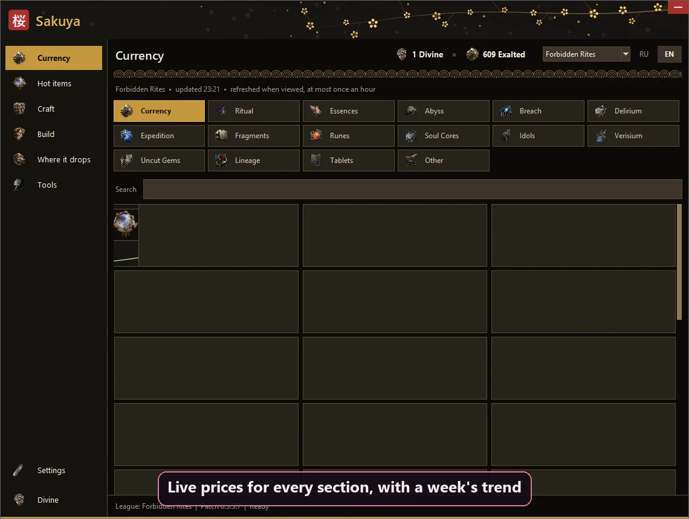
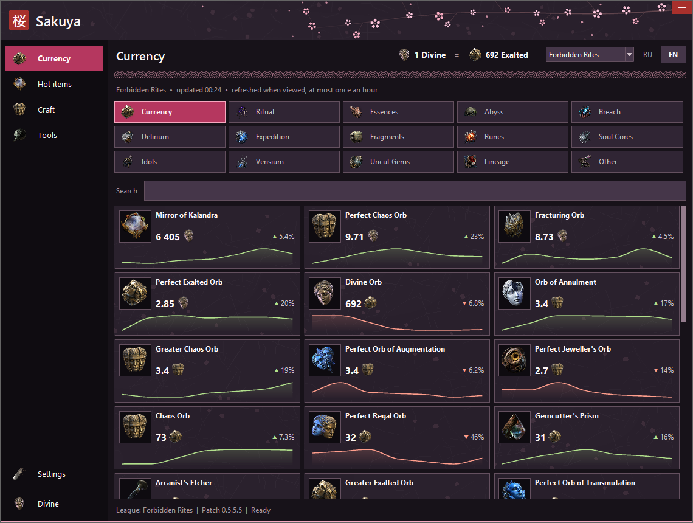
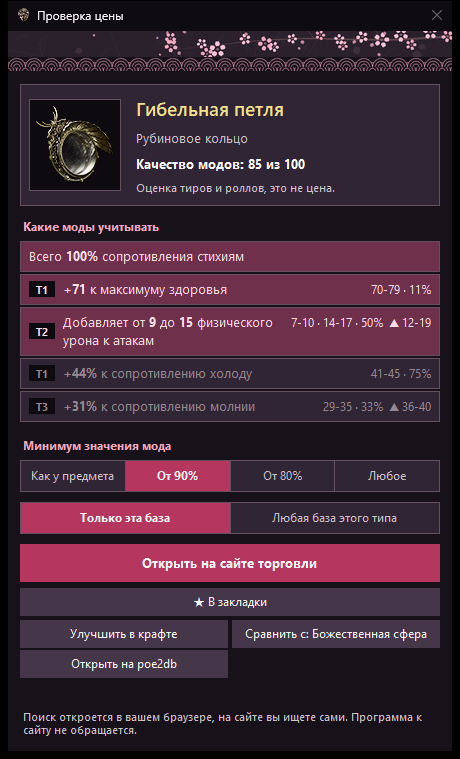
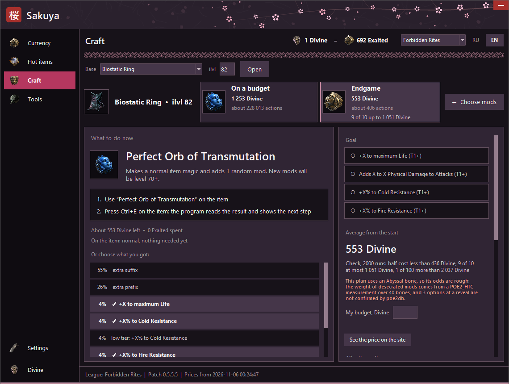
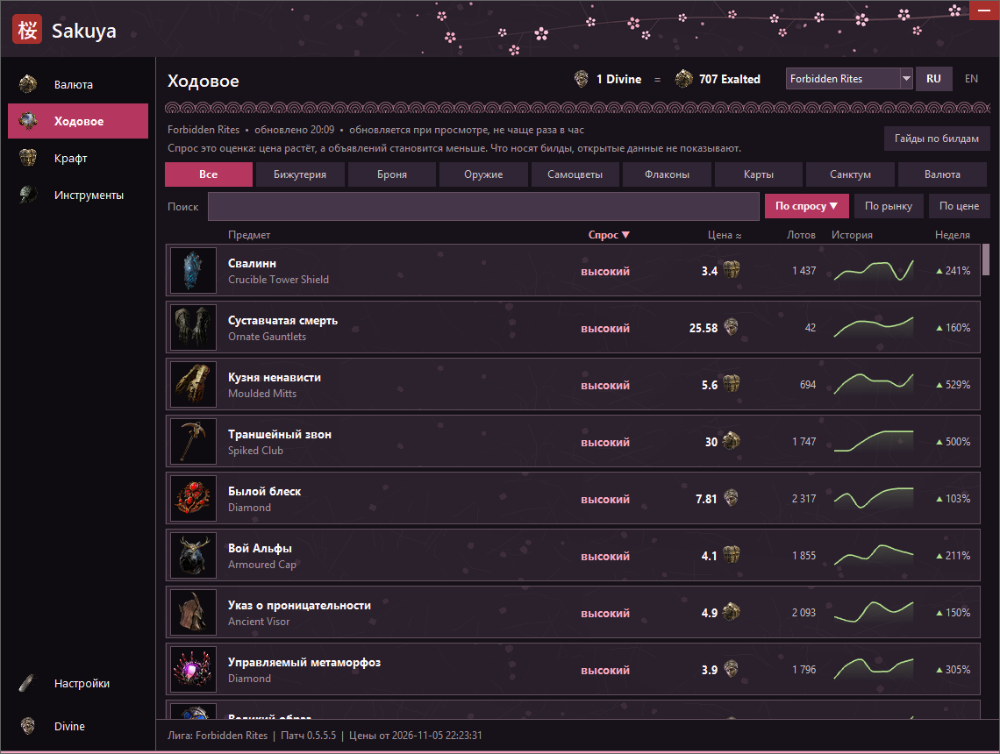

# Sakuya

A desktop helper for **Path of Exile 2** on Windows: a crafting planner, price checks and market lists in one small window that lives in the tray. English and Russian game clients are supported.

**[⬇ Download Sakuya.exe](https://github.com/dcser1Co1a/sakuya-poe2/releases/latest/download/Sakuya.exe)** · free · no login · does not connect to the game · Windows 10 and 11

[По-русски ниже](#по-русски)



| Prices | Price check | Crafting plan | Hot items |
|---|---|---|---|
|  |  |  |  |

## What it does

- **Crafting planner.** Hover an item in the game and press `Ctrl+E`. Pick the mods you want, and it works out the cheapest way there with real weights and current prices: chances, expected cost, and the next step after every orb. It reckons with omens, perfect and corrupted essences, alloys and warping runes such as Kolr's Hunt, whose mods have estimated chances, and it suggests fluxes, catalysts and quality items for the finish.
- **Price check.** Hover an item and press `Ctrl+D`. Currency and other stackable goods are priced from data already on your computer, with no request sent. Uniques show their average price, without counting rolls. Rare items show their tiers, rolls and a mod quality rating, which is not a price.
- **Trade search.** For rare and unique items, pick the mods and how close their values must be, and the official trade site opens in your browser with the search filled in. You search there yourself.
- **Market lists.** All currency sections with a week of price history, and uniques ranked by estimated demand.
- **Tools.** Saved searches, a deal journal, exchange turnover, a mod reference, a Waystone search line and a map timer.
- **Price watches.** Set a limit on any priced item, and a tray notice tells you when the price gets there. It uses the prices the program already downloads.
- **History.** The last 50 items you price-checked, with the price then and now and what they are worth together, kept on your computer.
- **Saved craft goals.** Save the mods you want on a base and open them again in one click.
- **Stash search line.** Build a line for the game's search box and paste it yourself.
- **Item tools.** The price window shows the next tier of each mod, what a tier up would cost, and compares two items. There is also a currency calculator and a place for notes.
- **League choice.** Trade, hardcore or Standard, picked at the top of the window. Each league keeps its own prices. Hardcore markets are thin: goods poe.ninja has no price for get an approximate one from GGG's public exchange data for the last hour, a good with no trades at all shows its last price if the program saw one, or says there are none, and plans are built only from what has a price. Uniques in hot items come from poe2scout, which tracks only the current trade leagues, so hardcore and Standard show currency there. SSF has no market, so it has no prices.
- **Three themes**, all with cherry blossom in them.

## Install

Download `Sakuya.exe` from [Releases](../../releases) and run it. It needs no installation and keeps its files in the folder it runs from, so give it a folder of its own.

The first start downloads mods, prices and pictures, which takes about seven minutes in the background: prices come within a minute, and mods for the planner last. The window can be used in the meantime. The file is not signed, so Windows SmartScreen or an antivirus may warn about it.

The game has to run in windowed fullscreen for the window to appear over it. The default keys can be changed in Settings:

| Key | Action |
|---|---|
| `Ctrl+E` | Open the item under the cursor in the planner |
| `Ctrl+D` | Check the item's price |
| `Ctrl+R` | Show or hide the window |

## How it stays up to date

Everything below happens by itself, with no action from you and no new version of the program:

| What | When |
|---|---|
| A new patch | Noticed from Steam's record within a second, or from Steam's public build number within a minute. The sites are then asked every two minutes until they publish it |
| Mods, weights, bases, unique items, Waystones | Read again when a patch comes out, and at least once a week |
| The list of mods for trade search | Looked at once a day |
| A new league | Checked every six hours and at every patch, and switched to by itself, in softcore or hardcore, whichever you play. A league you picked by name stays until it ends |
| Prices and hot items | Once an hour while the program is in use |
| New items | Priced as soon as they are listed, with their Russian names and pictures looked up by themselves |
| New market sections and categories | Looked for once a day and added when their data can be found |

New data is checked before it replaces what you have: if a site changes or sends nonsense, the old data stays and the program keeps working.

Some things cannot update by themselves. A new crafting mechanic, or a new omen's effect, has to be taught to the planner in code. The program tells you when a new version is out, but does not replace itself.

## Is it safe?

- **It does not connect to the game.** No game servers, no game memory, no game files, nothing injected into the game and no hooks into its window.
- **One key press, only when you press its hotkey.** It sends the game `Ctrl+Alt+C`, the game's own way of copying an item's text, the same way Exiled Exchange 2 and Sidekick read items. No macros, no automation, no whispers.
- **No login.** It never asks for your account, password or POESESSID.
- **It never contacts the trade site.** A search opens in your own browser, and you search there yourself.
- **What it downloads:** mods from poe2db, items and art from RePoE, prices from poe.ninja, poe2scout and GGG's public exchange data, the game's build number from SteamCMD, the list of trade stats from GitHub. Near the game it reads one thing: the build number in Steam's record of the installed game, to notice patches.
- **Nothing about you is sent anywhere.** Settings, notes and history stay in the program's folder.
- **Open source.** The `Sakuya.exe` on Releases is built from this code by GitHub Actions, and the build log is public.
- **Why Windows warns.** The file is not signed, as signing costs money, so SmartScreen shows "Windows protected your PC": click **More info**, then **Run anyway**. A few antiviruses mistake unsigned Python programs for threats. You can read the code, or build it yourself as shown below.

Grinding Gear Games does not approve or endorse any third-party tool, so nobody can promise anything in their name. Sakuya is made to keep within their [third-party policy](https://www.pathofexile.com/developer/docs): it plays nothing for you, reads nothing from the game and does not use the trade site. Read the policy and decide for yourself.

## Building it yourself

Python 3.13 or newer on Windows:

```
pip install -r requirements.txt pyinstaller
python -W ignore -m unittest test_crafter test_price_check test_trade_search test_market_demand test_tools test_craft_plans test_stability
pyinstaller --onefile --windowed --name Sakuya --icon assets/sakuya.ico crafter.py
```

Or run it from source with `python crafter.py`. Pushing a tag such as `v1.0.0` builds the program and publishes a release through GitHub Actions.

## Credits

Made by Divine.

- Mods and weights: [poe2db](https://poe2db.tw)
- Items and art: [RePoE](https://repoe-fork.github.io/poe2/)
- Prices: [poe.ninja](https://poe.ninja), [poe2scout](https://poe2scout.com)
- Build numbers: [SteamCMD API](https://www.steamcmd.net)
- List of trade stats: [Exiled Exchange 2](https://github.com/Kvan7/Exiled-Exchange-2) (MIT License, Copyright (c) 2020 Alexander Drozdov)
- Desecrated mod weight measured by POE2_HTC

## Support

Sakuya is free and stays free. If it saved you some orbs and you want to say thanks, USDT on the **Tron (TRC20)** network only:

```
TVwS7gPpNCBY1PAzAbgciWiJJoYQZDFzz1
```

Other networks or coins sent to this address are lost. The same address can be copied from the tray menu or the Divine page. Bug reports and ideas are just as welcome in [Issues](../../issues).

## License

[MIT](LICENSE).

This product isn't affiliated with or endorsed by Grinding Gear Games in any way. Path of Exile and its art belong to Grinding Gear Games.

*Made with love for Exiles, by Divine.*

---

## По-русски

Помощник для **Path of Exile 2** под Windows: планировщик крафта, проверка цен и списки рынка в одном небольшом окне, которое живёт в трее. Работает с русским и английским клиентом игры.

**[⬇ Скачать Sakuya.exe](https://github.com/dcser1Co1a/sakuya-poe2/releases/latest/download/Sakuya.exe)** · бесплатно · без входа в аккаунт · к игре не подключается · Windows 10 и 11

Короткое видео и снимки экрана — в начале страницы.

**Что умеет**

- **Крафт.** Наведите курсор на предмет в игре и нажмите `Ctrl+E`. Выберите нужные моды, и программа посчитает самый дешёвый путь по настоящим весам и текущим ценам: шансы, ожидаемые траты и следующий шаг после каждой сферы. Учитываются знамения, совершенные и порченые эссенции, сплавы и руны искажения вроде «Охоты Колра», шансы модов которых оценочные, а в конце программа подскажет расплавы, катализаторы и сферы качества.
- **Цена.** Наведите курсор на предмет и нажмите `Ctrl+D`. Цены валюты уже лежат у вас на компьютере, запрос не отправляется. Для уников показывается средняя цена без учёта роллов. Для редких предметов показываются тиры, роллы и оценка качества модов, это не цена.
- **Поиск на сайте торговли.** Для редких и уникальных предметов выберите моды и насколько близкими должны быть значения, и официальный сайт откроется в браузере с заполненным поиском. Ищете там вы сами.
- **Рынок.** Все разделы валюты с графиком за неделю и уники по оценке спроса.
- **Инструменты.** Закладки, журнал сделок, оборот биржи, справочник модов, строка поиска для путевых камней и секундомер.
- **Слежение за ценой.** Поставьте порог на любой предмет с ценой, и уведомление в трее скажет, когда цена до него дойдёт. Используются цены, которые программа и так скачивает.
- **История.** Последние 50 проверенных предметов с ценой тогда и сейчас и общей суммой. Лежит только у вас на компьютере.
- **Сохранённые цели крафта.** Сохраните нужные моды на базу и открывайте их в один клик.
- **Строка для тайника.** Соберите строку для поиска в игре и вставьте её сами.
- **Для предметов.** Окно цены показывает следующий тир каждого мода и цену улучшения на тир, а также сравнивает два предмета. Есть калькулятор валюты и заметки.
- **Выбор лиги.** Торговая, хардкор или Standard, переключается вверху окна. У каждой лиги свои цены. Рынок хардкора маленький: товары без цены на poe.ninja получают примерную цену из публичных данных биржи GGG за прошлый час, у товара совсем без обменов будет показана последняя цена, если программа её видела, или сообщение, что обменов нет, а планы крафта строятся только из того, у чего есть цена. Уники в «Ходовом» берутся с poe2scout, а он считает их только в текущих торговых лигах, поэтому в хардкоре и Standard там будет только валюта. В SSF нет рынка, поэтому нет и цен.

**Установка.** Скачайте `Sakuya.exe` из [Releases](../../releases), положите в отдельную папку и запустите. Первый запуск скачивает данные примерно за семь минут в фоне: цены приходят меньше чем за минуту, моды для крафта последними. Окном при этом уже можно пользоваться. Файл не подписан, поэтому SmartScreen или антивирус могут предупредить о нём. Игра должна быть в оконном режиме без рамок.

**Обновления.** Базы, цены, новые лиги и предметы обновляются сами: патч замечается за секунду по записи Steam или за минуту по публичному номеру сборки. Новые данные сначала проверяются, и при сбое остаются старые. Сами не обновляются новые механики крафта: для них нужна новая версия, о выходе которой программа сообщит.

**Это безопасно?**

- **К игре не подключается.** Ни к серверам игры, ни к её памяти, ни к файлам. Ничего не внедряет в игру и не цепляется к её окну.
- **Одно нажатие, только по вашей клавише.** Программа отправляет игре `Ctrl+Alt+C`, родной способ игры скопировать текст предмета. Так же читают предметы Exiled Exchange 2 и Sidekick. Никаких макросов, автоматизации и шёпотов.
- **Без входа.** Не просит аккаунт, пароль или POESESSID.
- **Не обращается к сайту торговли.** Поиск открывается в вашем браузере, ищете там вы сами.
- **Что скачивает:** моды с poe2db, предметы и картинки с RePoE, цены с poe.ninja, poe2scout и из публичных данных биржи GGG, номер сборки игры со SteamCMD, список модов для поиска с GitHub. Рядом с игрой читает одно: номер сборки в записи Steam об установленной игре, чтобы заметить патч.
- **О вас ничего никуда не отправляется.** Настройки, заметки и история лежат в папке программы.
- **Открытый код.** `Sakuya.exe` в Releases собирает из этого кода GitHub Actions, журнал сборки открыт.
- **Почему ругается Windows.** Файл не подписан: подпись стоит денег. SmartScreen покажет «Windows защитила ваш компьютер»: нажмите **Подробнее**, затем **Выполнить в любом случае**. Некоторые антивирусы по ошибке принимают неподписанные программы на Python за угрозу. Код можно прочитать или собрать программу самому.

Grinding Gear Games не одобряет никакие сторонние программы, поэтому обещать что-то от их имени не может никто. Sakuya сделана так, чтобы оставаться в рамках их [правил для сторонних программ](https://www.pathofexile.com/developer/docs): ничего не делает в игре за вас, ничего не читает из игры и не обращается к сайту торговли.

**Поддержать.** Программа бесплатная и такой останется. Если она сберегла вам сферы и хочется сказать спасибо: USDT только в сети **Tron (TRC20)**, адрес `TVwS7gPpNCBY1PAzAbgciWiJJoYQZDFzz1`. Монеты в других сетях на этот адрес пропадут. Адрес можно скопировать и из меню значка в трее или в разделе «Divine». Ошибки и идеи пишите в [Issues](../../issues).

Лицензия [MIT](LICENSE). Программа никак не связана с Grinding Gear Games и не одобрена ими.

*С любовью к изгнанникам, от Divine.*
